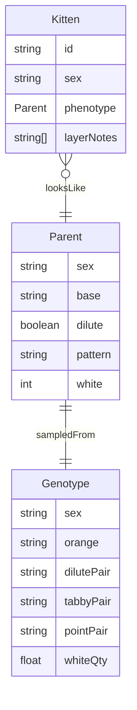

# feat: 猫咪花色生育小游戏 demo

产品决策来源：`docs/brainstorms/2026-09-23-cat-coat-genetics-game-brainstorm.md`。

## Overview

本地可打开的单页网页：左右捏妈妈/爸爸花色，点「生育」抽出 4–6 只带公母的扁平插画小猫，点开后用底色 / 纹样 / 白斑三行对照爸妈。遗传半真实：红/黑/玳瑁走简化性连锁；稀释、纹样、白斑用简表。界面不出现基因符号。无后端、无账号。

## Stack

- Vite + React + TypeScript
- 猫：一张 SVG 模板 + 图层填色（身体、纹样、白斑、五官）
- 遗传纯函数 + Vitest
- 文案中文

不采用单文件 HTML（遗传难测）或 Canvas（图层点选差）。

## 页面结构

```
[ 妈妈编辑器 + 预览 ]     [ 爸爸编辑器 + 预览 ]
              [ 生育 ]  [ 再生一窝 ]
[ 一窝小猫网格；未生过时是空状态 ]
[ 选中小猫：三层对照 + 一句人话 ]
```

- 桌面：亲本左右；窄屏：亲本上下叠。
- 改亲本不改已生出的那窝（快照），直到再点生育。
- v1 不能把小猫拖去当亲本。

## 数据模型

界面捏的是表型；首次创建亲本时抽样匹配的隐藏信息；只在对应性状改变时更新该部分，其余隐藏信息保持稳定。玩家只看到表型。



### 口语枚举

| 层 | 玩家选项 | 显示结果 |
|---|---|---|
| 底色 | 黑 / 红 / 玳瑁（仅母） | 深：黑、红、玳瑁；浅：蓝、奶油、淡玳瑁 |
| 稀释 | 深 / 浅 | 浅 = 稀释纯合 |
| 纹样 | 纯色 / 虎斑 / 重点色 | 三选一画面 |
| 白斑 | 0–3 档 | 无 → 手套胸巾 → 半白 → 大白；玳瑁+白多 = 三花观感 |
| 性别 | 亲本固定公/母；小猫抽 | 公略大头/身体，加小标记，并配文字 |

公猫编辑器没有玳瑁。若从母猫切到公猫且底色是玳瑁，则落到黑或红。

## 遗传规则

每只小猫：先抽性别（约 1:1），再抽各层。

### 底色（性连锁，测试必须锁死）

- 公：一条「红或黑」，来自妈妈随机一条 X。
- 母：两条 X = 妈妈随机一条 + 爸爸那条。
- 母两条不同 → 玳瑁；公默认不能玳瑁。
- 彩蛋：约 0.3% 公猫强制玳瑁，解释写「极少见的公玳瑁」。

对照表：

- 红公 × 黑母 → 儿子偏黑，女儿玳瑁
- 黑公 × 红母 → 儿子偏红，女儿玳瑁
- 双红 → 整窝红；双黑 → 无红（除非彩蛋）

### 稀释

浅 = 隐性纯合。表型深的亲本有概率是携带者，两只深猫可以生出浅猫。

### 纹样（玩具向）

可见纹样权重大，每只亲本可携带其他纹。重点色更「藏」（偏隐性）；虎斑对纯色偏常见。画面优先级：**重点色 > 虎斑 > 纯色**。不要为了真实虎斑显性而取消「纯色亲本生出带纹」。

### 白斑

子代约在父母中点附近抖动一档，夹在 0–3。不要整窝克隆。两只无白不应打出大白；抖动要小。

### 解释器

三层各一句，读取本次生成记录（继承来源、抽取结果、亲本快照），禁止根据外观倒推来源，禁止基因符号。例如：「底色是玳瑁，因为妈妈带红、爸爸带黑，而它是母猫。」白斑用「更像妈妈 / 介于中间 / 白得更多」。`explain` 必须根据本次实际表型生成，不得与结果矛盾。

## 建议文件

```
src/genetics/types.ts
src/genetics/sampleGenotype.ts
src/genetics/breed.ts
src/genetics/explain.ts
src/genetics/*.test.ts
src/cat/palette.ts
src/cat/CatSvg.tsx
src/ui/ParentEditor.tsx
src/ui/LitterGrid.tsx
src/ui/KittenDetail.tsx
src/App.tsx
```

`CatSvg` 只吃表型。图层顺序固定：**身体 → 纹样 → 重点色 → 白斑 → 五官**。重点色 + 大白时至少留脸/手脚可读。

## 实现顺序

1. 遗传纯函数 + 测试（不写 UI）：红黑性连锁、稀释隐性、公玳瑁彩蛋、白斑抖动范围。
2. `CatSvg` + 调色板：改 props 立刻变花色；公母可区分。
3. `ParentEditor`：左右各一；选项绑定表型并仅更新受影响的隐藏信息。
4. 生育 + 一窝 + 对照：4–6 只；空状态；选中态；再生一窝替换本窝。
5. 文案与窄屏：抽查常见配对解释句；亲本上下叠仍能点完一轮。

## 用户流与边角

- 主路径：调妈 → 调爸 → 生育 → 点小猫 → 读三层 → 再生一窝。
- 未生育：网格空，对照区提示先生育。
- 改亲本：预览变，旧窝不变。
- 公猫禁玳瑁；母猫允许。
- SVG 与卡片可点选；性别不单靠颜色。

## Acceptance Criteria

- [ ] 捏两只猫，花色预览即时变化
- [ ] 生育得到 4–6 只，大样本下公母大约一半
- [ ] 红公×黑母、黑公×红母的子女底色符合对照表
- [ ] 点小猫出现三层对照 + 人话，无基因符号
- [ ] 固定种子可复现；多个种子下结果符合规则，不强制每窝花色不同
- [ ] 玳瑁几乎都是母；公玳瑁极稀
- [ ] 无后端；刷新回到初始亲本

## v1 明确不做

多代族谱、子代升亲本、长毛、银尖、品种、分享图、存档、音效、养成数值。

## Risks

- 纹样若完全按真实显性，会和「纯色生出虎斑」打架 → v1 用加权 + 携带者；红黑仍走真性连锁。
- SVG 图层顺序错会让白斑吃掉虎斑 → 遵守固定图层顺序。
- 解释句与抽签不一致会穿帮 → 解释读取本次生成记录与亲本快照。


## 2026-09-25 开发补充

用户确认：解释应依据本次生成记录，而非仅凭表型和性别推测。具体设计及本轮实现范围见 `2026-09-25-demo-design-addendum.md`；冲突处以该补充为准。
